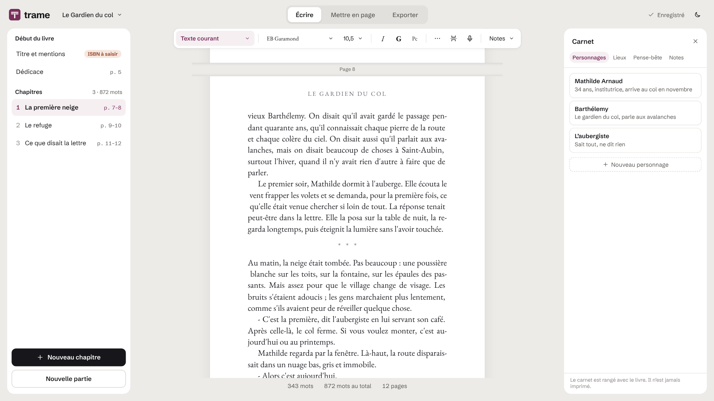
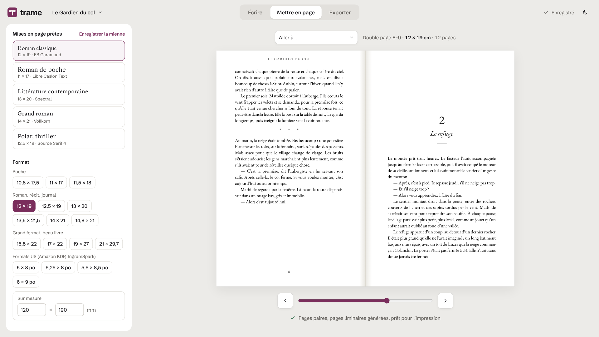
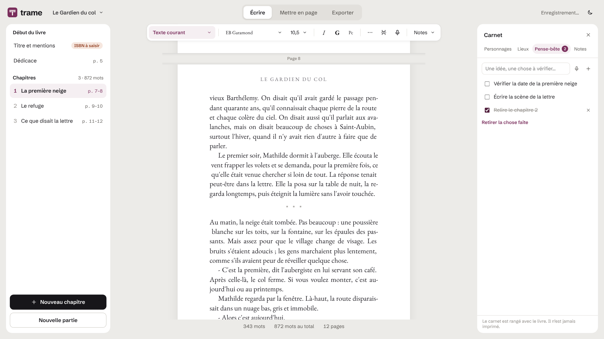

<h1 align="center">Trame</h1>

<strong>Écrire un livre, et le voir prendre forme.</strong> 
Un espace d'écriture calme, et une mise en page automatique prête pour l'imprimeur.

<table>
<tr>
<td width="50%"> La mise en page, en double page</td>
<td width="50%"> Le Carnet : personnages, lieux, pense-bête</td>
</tr>
</table>

---

- **Écrire** sur de vraies pages, au format exact de votre livre.
- **Mettre en page** en quelques clics : 17 formats (dont 12 × 19 cm), 14 polices libres, des mises en page prêtes.
- **Exporter** un PDF prêt pour l'impression (BoD, Amazon KDP…), typographie française comprise.
- **Importer** un manuscrit Word (.docx), texte ou Markdown.
- **Typographie française pendant la frappe** : tirets de dialogue, guillemets « », espaces insécables.
- **Correcteur d'orthographe** intégré, hors ligne.
- **Le Carnet** de l'auteur : personnages, lieux, pense-bête.
- **Début et fin du livre** : biographie, préface, remerciements, table des matières automatique.
- **Mode sombre**, bibliothèque de livres, dictée vocale, et mises à jour automatiques.

Vos livres restent sur votre ordinateur : Trame ne collecte aucune donnée.

### Installer

**Windows**

1. Téléchargez `Trame_…_x64-setup.exe` depuis la [dernière version](https://github.com/shizeh/trame-versions/releases/latest).
2. Ouvrez-le. Si Windows affiche « Windows a protégé votre ordinateur », cliquez sur **Informations complémentaires**, puis **Exécuter quand même**.
3. Ensuite, Trame se met à jour toute seule.

**Mac** (Apple Silicon et Intel, macOS 11 ou plus récent)

1. Téléchargez [`Trame.dmg`](https://github.com/shizeh/trame-versions/releases/download/mac/Trame.dmg), ouvrez-le et glissez Trame dans **Applications**.
2. Au premier lancement, le Mac affiche une alerte : allez dans **Réglages Système > Confidentialité et sécurité**, puis cliquez sur **Ouvrir quand même**. C'est à faire une seule fois.
3. Ensuite, Trame se met à jour toute seule. Vos fichiers `.trame` passent de Windows à Mac.

---

Créée par [Baptiste Shizeh](https://github.com/shizeh). Ce dépôt ne contient que les versions publiées de Trame.

[Signaler un problème ou proposer une idée](https://github.com/shizeh/trame-versions/issues/new/choose) · [Confidentialité](CONFIDENTIALITE.md)
